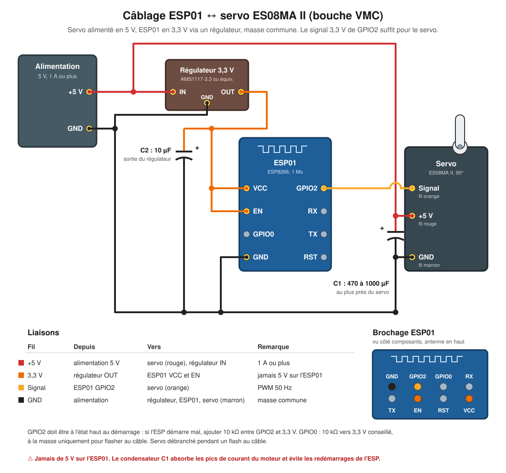

# Bouche VMC motorisée (ESPHome)

Firmware ESPHome pour une bouche de VMC à volet dosant l'ouverture, pilotée par un **ESP01 (ESP8266, 1 Mo)** et un **servo 90° ES08MA II**. La bouche apparaît nativement dans Home Assistant comme un volet d'aération (`cover`, `device_class: damper`), avec ses butées, sa vitesse et son relâchement réglables depuis HA.


## Points forts

- **Le servo ne force jamais en continu** : à l'arrivée, après un court délai, le signal PWM est coupé. Le servo n'est plus asservi, ne chauffe plus et ne pousse plus contre une butée.
- **Mouvement en rampe douce**, à vitesse réglable (moins de pic de courant, moins de bruit).
- **Aucun à-coup au démarrage** : la position est mémorisée en flash et rien n'est envoyé au servo tant qu'aucun ordre n'arrive.
- **Butées en degrés**, réglées par bouche depuis Home Assistant, sans recompiler.
- **Un seul modèle pour toutes les bouches** : chaque bouche n'est qu'un fichier de 4 substitutions qui charge ce dépôt à distance.

## Câblage

Le servo est alimenté en **5 V**, l'ESP01 en **3,3 V** (via un régulateur), avec une **masse commune**. Le signal 3,3 V de l'ESP suffit pour piloter le servo.



(version PNG : [`docs/schema-cablage-esp01-servo.png`](docs/schema-cablage-esp01-servo.png))

| ESP01 | Relié à | Remarque |
|---|---|---|
| VCC | 3,3 V du régulateur | Jamais 5 V sur l'ESP01 |
| EN (CH_PD) | 3,3 V | Directement ou via 10 kΩ |
| GND | masse commune | |
| GPIO2 | signal du servo (orange) | Doit être à l'état haut au démarrage : 10 kΩ vers 3,3 V si l'ESP ne démarre pas de façon fiable |
| GPIO0 | libre (10 kΩ vers 3,3 V conseillé) | À la masse uniquement pour flasher au câble |
| RST, TX, RX | libres | |

Conseils :

- Un **condensateur de 470 à 1000 µF** sur le 5 V, au plus près du servo, absorbe les pics de courant au démarrage du moteur et évite les redémarrages de l'ESP.
- Au démarrage, le bootloader de l'ESP8266 émet quelques signaux sur GPIO2, ce qui peut faire tressaillir le servo une fraction de seconde. Si votre câblage le permet, GPIO3 (RX) n'a pas ce défaut (mettre alors `log_baud_rate: "0"`).

## Installation

### 1. Les secrets

Dans le `secrets.yaml` de votre dossier ESPHome (voir [`exemples/secrets.yaml.exemple`](exemples/secrets.yaml.exemple)) :

```yaml
wifi-iot_ssid: "MonWifi"
wifi-iot_password: "motdepasse"
api_key: "..."   # openssl rand -base64 32
```

Les secrets restent chez vous : le modèle du dépôt ne fait que les référencer avec `!secret`.

### 2. Un fichier par bouche

Dans ESPHome Device Builder, créer un appareil et remplacer son contenu par :

```yaml
substitutions:
  name: vmc-wc                 # nom réseau (minuscules, tirets)
  friendly_name: VMC WC        # nom de l'appareil dans Home Assistant
  servo_pin: GPIO2             # broche du signal servo
  log_baud_rate: "115200"      # mettre "0" si servo_pin est GPIO1 ou GPIO3

packages:
  commun: github://sarus3749/esphome-bouche-vmc/bouche-vmc-commun.yaml@main
```

Des exemples prêts à l'emploi sont dans [`exemples/`](exemples/).

Avec `@main`, ESPHome rafraîchit le modèle au plus une fois par jour. Pour figer une version si besoin, remplacez `main` par un tag ou un commit.

### 3. Compiler et flasher

> **Toujours la carte `esp01_1m`** (c'est le cas dans le modèle). La compilation doit afficher `from 1023984 bytes`. Un firmware compilé pour `esp01` (512 Ko, choix par défaut de l'assistant ESPHome) n'accepte plus aucune mise à jour sans fil d'ESPHome.

- **Première fois, au câble** : *Install* → *Manual download* → format « Modern », puis flasher via un adaptateur USB-série 3,3 V (GPIO0 à la masse au démarrage, servo débranché), avec [ESPHome Web](https://web.esphome.io) ou `esptool.py write_flash 0x0 firmware.bin`.
- **Depuis Tasmota, sans câble** : *Firmware Upgrade* vers `tasmota-minimal` (`OtaUrl http://ota.tasmota.com/tasmota/release/tasmota-minimal.bin.gz` puis `Upgrade 1`), puis envoyer le `.bin` ESPHome (format « Legacy ») par *Firmware Upgrade*.
- **Ensuite** : *Install* → *Wirelessly*.

Le firmware fait environ 385 Ko : il se met à jour par-dessus lui-même sur 1 Mo. Si une OTA est refusée faute de place (ancien firmware trop gros), installer d'abord le tremplin [`exemples/bouche-ota-minimal.yaml`](exemples/bouche-ota-minimal.yaml) (~300 Ko, même `name`), puis le fichier normal.

## Dans Home Assistant

| Entité | Catégorie | Rôle |
|---|---|---|
| *VMC WC* (cover, damper) | | Position 0 à 100 %, ouvrir, fermer, stop |
| Angle fermé | Configuration | Butée fermée, 0 à 90° (pas de 0,5°) |
| Angle ouvert | Configuration | Butée ouverte, 0 à 90° |
| Vitesse | Configuration | En %/s de la course (25 = course complète en 4 s) |
| Délai avant relâchement | Configuration | Temps de maintien après l'arrivée, en ms (500 par défaut) |
| Recaler le servo | Configuration | Renvoie la position mémorisée (volet bougé à la main) |
| Redémarrer | Configuration | |
| Servo maintenu | Diagnostic | Allumé pendant le mouvement, éteint une fois le servo relâché |
| Signal Wi-Fi | Diagnostic | |

Les réglages sont conservés en flash. Les services standards `cover.open_cover`, `cover.close_cover` et `cover.set_cover_position` fonctionnent tels quels.

## Calibration (une fois par bouche)

1. Ouvrir l'appareil dans HA, section *Configuration*. Mettre la `Vitesse` à 10 %/s.
2. `Angle fermé` : changer par pas de 1 à 2°. **Le volet va tout de suite à la nouvelle valeur.** S'arrêter quand il touche son siège, puis **revenir de 2 à 4°** : fermé, mais sans que le servo force (ni bourdonnement ni échauffement).
3. `Angle ouvert` : même principe, juste avant la butée mécanique, avec la même marge.
4. Remettre la vitesse voulue (20 à 30 %/s est un bon compromis).

Valeurs de départ prudentes : fermé 30°, ouvert 60°. Elles ne s'appliquent qu'au tout premier démarrage d'une bouche.

**Sens inversé** (servo monté à l'envers) : il suffit de mettre un angle fermé plus grand que l'angle ouvert.

## Correspondance angle / impulsion

0° = 1000 µs, 45° = 1500 µs, 90° = 2000 µs, à 50 Hz (valeurs nominales d'un servo 90°). Pour un autre servo, surcharger dans le fichier de la bouche :

```yaml
substitutions:
  servo_us_0deg: "1000"
  servo_us_90deg: "2000"
```

## Comment ça marche

1. Un ordre fixe une impulsion cible entre les deux butées.
2. Une boucle de 20 ms rapproche l'impulsion de la cible à la vitesse réglée et publie la position à HA (4 fois par seconde pendant le mouvement).
3. À l'arrivée, après le délai réglé, le PWM est coupé.
4. L'impulsion courante est sauvegardée en flash (au plus toutes les 30 s). Au redémarrage, elle sert à rapporter la position, sans rien envoyer au servo.

## Fichiers

| Fichier | Rôle |
|---|---|
| [`bouche-vmc-commun.yaml`](bouche-vmc-commun.yaml) | Le modèle : toute la logique, chargé à distance par chaque bouche |
| [`exemples/bouche-*.yaml`](exemples/) | Un fichier par bouche (WC, SdB, cuisine) |
| [`exemples/bouche-ota-minimal.yaml`](exemples/bouche-ota-minimal.yaml) | Firmware tremplin pour débloquer une OTA |
| [`exemples/secrets.yaml.exemple`](exemples/secrets.yaml.exemple) | Les clés à mettre dans votre `secrets.yaml` |
| [`docs/`](docs/) | Schéma de câblage (SVG + PNG) |

## Licence

MIT
